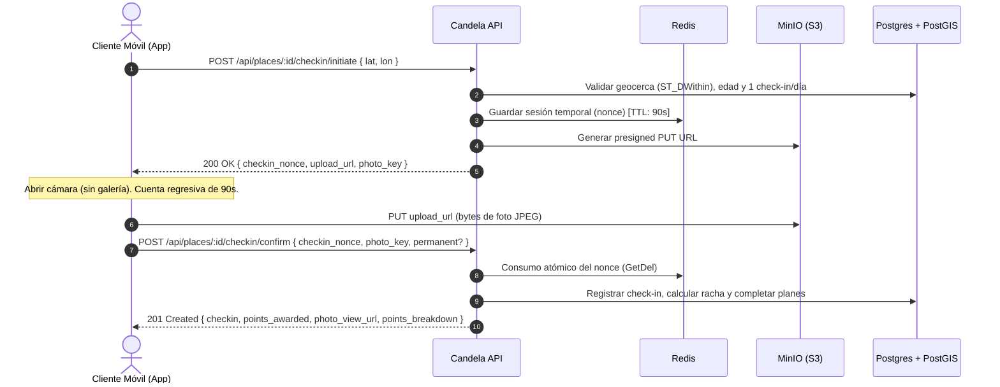

# Candela API — Frontend Integration Guide

Guía oficial de integración entre el frontend de **Candela** y el backend REST en Go.
Todo lo contenido en este documento se deriva de la implementación real del servidor. No asumas comportamientos — lee esta guía.

---

## 1. Flujo de Autenticación y Gestión de Sesión

### 1.1 Registro Tradicional
Enviar `POST /api/auth/register` con `email`, `username` (3–50 chars), `password` (mínimo 8 chars) y `birth_date` (`YYYY-MM-DD`).
En `201 Created`, la respuesta retorna la sesión completa:
```json
{
  "token": "<access_jwt>",
  "refresh_token": "<refresh_uuid_or_crypto_token>",
  "expires_in": 900,
  "user": { ... }
}
```
- **Modo de privacidad por defecto:** `"FRIENDS"`.
- **Restricción de edad:** El servidor rechaza a menores de 18 años con `422 Unprocessable Entity` (`"Debes ser mayor de 18 años para usar Candela."`). Muestra este mensaje claramente en la UI.

### 1.2 Inicio de Sesión
`POST /api/auth/login` con `email` y `password` devuelve la misma estructura `{ token, refresh_token, expires_in, user }` en `200 OK`.

### 1.3 Google OAuth (Flujo en 2 Pasos)
1. **Verificación / Login:** Enviar `POST /api/auth/google` con `{ "id_token": "<google_id_token>" }`.
   - Si el usuario ya existe: Retorna `200 OK` con `{ token, refresh_token, expires_in, user }`.
   - Si el email de Google es válido pero no está registrado: Retorna `200 OK` con:
     ```json
     {
       "needs_registration": true,
       "email": "usuario@gmail.com"
     }
     ```
     La app debe redirigir a la pantalla de completar perfil solicitando `username` y `birth_date`.
2. **Completar Registro:** Enviar `POST /api/auth/google/register` con `{ "id_token": "...", "username": "...", "birth_date": "YYYY-MM-DD" }`. Retorna `201 Created` con la sesión (`token`, `refresh_token`, `expires_in`, `user`).
   - Las cuentas creadas con Google **no tienen contraseña**. Si intentan iniciar sesión por `POST /api/auth/login`, el servidor responderá `401 Unauthorized`: `"Esta cuenta entra con Google."`.

### 1.4 Ciclo de Vida del Token y Renovación Silenciosa
- **Access Token (JWT):** Expira en **15 minutos** (`expires_in: 900`).
- **Refresh Token:** Token criptográfico opaco y persistente para renovación de sesión.
- **Almacenamiento seguro:** Guarda ambos tokens exclusivamente en almacenamiento seguro cifrado (`flutter_secure_storage`: Keychain en iOS, Keystore cifrado con hardware en Android). Nunca uses `SharedPreferences` plano ni `localStorage`.
- **Renovación de sesión:**
  Llama a `POST /api/auth/refresh` con:
  ```json
  { "refresh_token": "<token_actual>" }
  ```
  Retorna `200 OK` con un nuevo par de tokens (`token` y `refresh_token` rotado).
  
  > [!IMPORTANT]
  > **Rotación Atómica y Detección de Reúso (RFC 6819):** Cada llamada a `/refresh` invalida el refresh token utilizado y emite uno nuevo. Si un refresh token ya usado vuelve a enviarse (por ejemplo, en llamadas paralelas desincronizadas o por replay attack), el servidor revoca en cascada todas las sesiones activas del usuario.
  > Implementa un **mutex o promesa compartida (`_refreshInFlight`)** en el cliente para que múltiples peticiones concurrentes que reciban un 401 compartan una sola llamada de refresco.

### 1.5 Cierre de Sesión (Logout)
Enviar `POST /api/auth/logout` con `{ "refresh_token": "<token_actual>" }` -> `204 No Content`.
Revoca la sesión en la base de datos para este dispositivo. Siempre limpia el almacenamiento seguro local, incluso si hay un fallo de red.

### 1.6 Casos Especiales de Error 401 y 403
- `401` con `"invalid or expired token"`: Intenta refrescar la sesión con `/api/auth/refresh`. Si el refresco falla, redirige al login.
- `401` con `"account no longer active"`: La cuenta fue eliminada y el JWT está en la blocklist de Redis. Limpia todo el estado local y muestra mensaje de cuenta eliminada.
- `403` con `"Tu cuenta está suspendida. Escríbenos si crees que es un error."`: Cuenta suspendida o dada de baja. Bloquea el acceso a la app.

### 1.7 Claims del JWT útiles en Cliente
Decodifica el payload en base64 para inspección local:
| Claim | Tipo | Uso |
|---|---|---|
| `sub` | string (UUID) | ID del usuario autenticado (usado en URLs y validación de permisos). |
| `email` | string | Email del usuario. |
| `is_protected` | bool | Si es `true`, desactiva la opción de privacidad `PUBLIC` en ajustes. |
| `account_status`| string | `ACTIVE`, `SUSPENDED` o `DELETED`. |
| `exp` | number | Timestamp Unix de expiración (para planificar refrescos proactivos). |

---

## 2. Perfil Propio y Ajustes (`/api/me`)

### 2.1 Carga del Perfil Propio
Llamar a `GET /api/me` al iniciar la app y tras acciones que modifiquen puntos, planes o amigos.
La respuesta (`MyProfile`) incluye:
```json
{
  "user_id": "uuid",
  "email": "juan@example.com",
  "username": "juancho",
  "birth_date": "2000-05-12T00:00:00Z",
  "age": 26,
  "is_protected": false,
  "account_status": "ACTIVE",
  "privacy_mode": "FRIENDS",
  "points_total": 420,
  "points_season": 150,
  "badge_level": "Callejero",
  "streak_weeks_current": 3,
  "streak_weeks_max": 5,
  "streak_week_checkins": 2,
  "streak_week_start": "2026-09-14T00:00:00Z",
  "streak_last_checkin": "2026-09-16T22:30:00Z",
  "ranking_opt_in": true,
  "created_at": "...",
  "updated_at": "...",
  "check_in_count": 14,
  "friends_count": 8,
  "completed_plans_count": 3
}
```
*Campos sensibles como `password_hash`, `guardian_token` y `guardian_contact` nunca se devuelven.*

### 2.2 Historial Propio de Check-ins
`GET /api/me/check-ins?limit=20&before=<timestamp_iso8601>`
- Paginación basada en tiempo con parámetro `before` (cursor RFC3339Nano).
- Si no hay más páginas, `next_cursor` es `null`.
- `photo_url` será `null` si el TTL de 24 horas expiró y la foto no fue marcada como permanente. **Nunca ocultes el check-in**, solo muestra un placeholder de foto expirada.

### 2.3 Historial Propio de Planes
`GET /api/me/plans?status=<filtro>`
Filtros aceptados (contrato público en español, inglés aceptado por compatibilidad):
- `activos` (`active`): Planes en estado `PENDIENTE` y `ACEPTADO`.
- `concretados` (`completed`): Planes finalizados con éxito mediante check-in.
- `no_concretados` (`failed`): Planes expirados o declinados.

Cada elemento incluye `role`: `"creator"` o `"target"` / `"guest"`.

### 2.4 Actualización de Privacidad
`PATCH /api/me/privacy` con `{ "privacy_mode": "PUBLIC" | "FRIENDS" | "PRIVATE" }`.
- Si `is_protected` es `true` o el usuario es menor de edad, el servidor rechaza `"PUBLIC"` con `422`.

### 2.5 Inclusión en Ranking Global
`PATCH /api/me/ranking` con `{ "ranking_opt_in": true | false }`.
- Permite al usuario decidir si compite públicamente en la tabla de posiciones de la ciudad.

### 2.6 Eliminación de Cuenta
`DELETE /api/me` -> `204 No Content`.
- Anonimiza los datos del usuario, revoca todas las sesiones, añade el JWT actual a la blocklist de Redis y programa la eliminación de fotos. Limpia el estado local y cierra sesión.

---

## 3. Flujo de Check-In en 2 Fases (Anti-Fraude y Presencia)

El check-in requiere **dos llamadas a la API** y **una subida directa a almacenamiento de objetos (MinIO/S3)**.



### Paso a Paso

1. **Permiso de Ubicación:** Solicita ubicación de alta precisión del dispositivo.
2. **Paso 1 — Iniciar Check-in:**
   `POST /api/places/:place_id/checkin/initiate` con `{ "lat": 10.9982, "lon": -74.8015 }`.
   - `422`: Fuera de la geocerca permitida (geocercas entre 20m y 150m, según lugar).
   - `409`: Ya hiciste check-in en este lugar hoy (ventana de vida nocturna `America/Bogota`). Muestra "Ya encendiste candela aquí hoy".
   - `403`: Lugar no apto para menores (`minor_suitability = 'NO'`).
   - `200 OK`: Retorna `{ checkin_nonce, upload_url, photo_key }`.
3. **Cámara Obligatoria:** Abre la cámara en la app inmediatamente. **Prohibido permitir selección desde la galería**.
4. **Temporizador de 90 Segundos:** Inicia una cuenta regresiva visual de 90 segundos al abrir la cámara. Si expira, el nonce en Redis se destruye. Cancela y reinicia desde el paso 2.
5. **Subida Directa de Foto (PUT a S3/MinIO):**
   ```http
   PUT <upload_url>
   Content-Type: image/jpeg
   Content-Length: <bytes_length>

   <bytes_binarios_de_la_foto>
   ```
   *Esta subida va directamente a MinIO/S3, no satura el servidor de la API.*
   
   > [!NOTE]
   > **Ajuste de Host en Entorno Local:** En emuladores Android, `upload_url` puede venir con `http://localhost:9000` o `http://minio:9000`. Reemplázalo con `http://10.0.2.2:9000` antes del `PUT`. En iOS Simulator o dispositivos físicos, usa la IP accesible de tu máquina en la red local.
6. **Paso 2 — Confirmar Check-in:**
   `POST /api/places/:place_id/checkin/confirm` con:
   ```json
   {
     "checkin_nonce": "<nonce_recibido>",
     "photo_key": "<photo_key_recibido>",
     "photo_is_permanent": false
   }
   ```
   - El servidor consume y borra el nonce atómicamente con `GetDel` (previene ataques de carrera y doble check-in).
   - Si había un plan social aceptado en este lugar, el backend lo marca automáticamente como `CONCRETADO` y acredita los puntos de bonificación.
   - Retorna `201 Created`:
     ```json
     {
       "checkin": { "checkin_id": "...", "points_awarded": 20, "is_first_of_day": true, ... },
       "points_awarded": 20,
       "is_first_of_day": true,
       "photo_view_url": "https://... (presigned GET 24h)",
       "points_breakdown": {
         "base": 10,
         "multiplier": 1.5,
         "subtotal_checkin": 30,
         "weekly_bonus": 5,
         "plan_bonus": 0,
         "total": 35
       }
     }
     ```

### 3.1 Fotos Efímeras vs Permanentes
- Por defecto, las fotos son **efímeras**: expiran a las 24 horas y el proceso *Janitor* del backend las borra.
- El usuario puede marcar/desmarcar su foto como permanente mientras el evento siga activo (últimas 4 horas desde el check-in):
  `PATCH /api/checkins/:checkin_id/permanent` con `{ "permanent": true | false }`.
  - `422`: El evento ya cerró (> 4h).
  - `403`: No eres el autor del check-in.

### 3.2 Sistema de Puntos y Multiplicadores de Racha
| Concepto | Puntos Base |
|---|---|
| Check-in Base | +10 pts |
| Primera visita del día en la ciudad | +5 pts |
| Check-in con foto válida | +5 pts |
| Plan social completado | +8 pts (creador) / +10 pts (invitado) |

**Multiplicador Semanal:**
- 1er check-in de la semana: $\times 1.0$
- 2do y 3er check-in de la semana: $\times 1.5$
- 4to check-in en adelante: $\times 2.0$
*(Aplica al subtotal de puntos de check-in y bonos de planes).*

**Bono de Consistencia Semanal:**
Se otorga en el 1er check-in de una nueva semana si sostienes la racha consecutiva:
- 4 a 7 semanas consecutivas: **+5 pts** (fijo)
- 8 semanas o más: **+10 pts** (fijo)

### 3.3 Niveles de Insignia (`badge_level`)
Los rangos reflejan el estatus social en la ciudad y se recalculan automáticamente:
- **Nuevo en la vuelta**: 0 a 149 pts
- **Callejero**: 150 a 499 pts
- **Parroquiano**: 500 a 1499 pts
- **Teso**: 1500 a 4999 pts
- **Leyenda**: 5000+ pts

---

## 4. Lugares y Descubrimiento en Mapa (`/api/places`)

### 4.1 Búsqueda de Lugares Cercanos
`GET /api/places/nearby?lat=10.998&lon=-74.801&radius_km=5.0&category=BAR`
Retorna `{ "data": Place[] }` ordenado por proximidad.
Campos relevantes por lugar:
- `place_id`, `name`, `description`, `category`.
- `lat`, `lon`, `geofence_meters` (radio de la geocerca para check-in).
- `minor_suitability`: `"YES"`, `"NO"`, `"PENDING"`.
- `is_verified`: Verificación oficial del comercio.
- `is_active`: Booleano que indica si el lugar está **"en candela ahora"** (actividad de check-ins en las últimas 4 horas). Usa esto para encender la llama visual en el pin del mapa.
- `active_checkins_count`: Personas con check-in activo en las últimas 4 horas.
- `distance`: Distancia calculada en metros respecto al centro consultado.

### 4.2 Detalle del Lugar
`GET /api/places/:place_id`
Retorna `PlaceDetail`:
- `is_followed`: Si el usuario autenticado sigue el lugar.
- `follower_count`: Total de seguidores.
- `active_checkins_count`, `last_checkin_at`, `is_active`.

### 4.3 Feed en Vivo del Lugar
`GET /api/places/:place_id/feed?limit=20&before=<timestamp_iso8601>`
Muestra los check-ins con foto realizados en este lugar durante las últimas 4 horas.

### 4.4 Seguir / Dejar de Seguir
- Seguir: `POST /api/places/:place_id/follow` -> `200 OK { "following": true, "follower_count": N }` (idempotente).
- Dejar de seguir: `DELETE /api/places/:place_id/follow` -> `200 OK { "following": false, "follower_count": N }`.

---

## 5. Planes Sociales ("Parches") — Sustituto de Retos (`/api/plans`)

Los planes sociales reemplazan el concepto de retos ("challenges"). Permiten armar parches en lugares específicos con plazos de 24, 48 o 72 horas.

### 5.1 Modalidades de Planes
1. **1 a 1 (`INVITE`):** Invitación directa a un amigo específico. Requiere `target_user_id`.
2. **Abierto a Amigos (`FRIENDS`):** Parche visible para todos los amigos del creador. `target_user_id` es `null`.
3. **Abierto al Público (`PUBLIC`):** Parche visible en el mapa para cualquier usuario dentro del radio de descubrimiento. `target_user_id` es `null`.

### 5.2 Crear un Plan
`POST /api/plans` con:
```json
{
  "place_id": "uuid-del-lugar",
  "visibility": "INVITE", // "INVITE" | "FRIENDS" | "PUBLIC"
  "deadline_hours": 24,   // Exclusivamente 24, 48 o 72
  "target_user_id": "uuid-del-amigo", // Obligatorio solo si visibility == "INVITE"
  "message": "¿Unas frias hoy?"       // Opcional
}
```
Errores comunes:
- `422`: Amistad requerida en planes 1-a-1 (`"Solo puedes invitar a planes a amigos confirmados."`).
- `409`: Plan idéntico pendiente activo (`"Ya tienes un plan pendiente con este usuario en este lugar."`).

### 5.3 Descubrir Planes Abiertos en el Mapa
`GET /api/plans/discover?lat=10.998&lon=-74.801&radius_km=5.0`
Retorna los planes abiertos (`PUBLIC` o `FRIENDS` de amigos) como pines en el mapa, incluyendo coordenadas del lugar, datos del creador y contador `participant_count`.

### 5.4 Unirse a un Plan Abierto
`POST /api/plans/:plan_id/join`
Cualquier usuario autorizado puede unirse a un plan abierto mientras siga en estado `PENDIENTE`.

### 5.5 Bandejas de Planes
- Recibidos / Invitaciones: `GET /api/plans/incoming`
- Creados / Enviados: `GET /api/plans/outgoing`
- Detalle de un plan: `GET /api/plans/:plan_id`

### 5.6 Aceptar, Declinar y Cancelar
- **Aceptar:** `POST /api/plans/:plan_id/accept` -> `200 OK` (solo el destinatario en planes `INVITE`).
- **Declinar:** `POST /api/plans/:plan_id/decline` -> `204 No Content` (solo el destinatario).
- **Cancelar:** `DELETE /api/plans/:plan_id` -> `204 No Content` (solo el creador, mientras esté `PENDIENTE`).

### 5.7 Estados del Plan (Respuestas en Español)
El servidor serializa los estados directamente en español:
- `PENDIENTE`: Esperando respuesta o esperando que empiece el parche.
- `ACEPTADO`: Confirmado. Muestra cuenta regresiva hasta `deadline_at`.
- `CONCRETADO`: ¡Completado! Registra fecha `concretado_at`.
- `NO_CONCRETADO`: Expiró el plazo sin check-in (evaluado automáticamente por el servidor de forma perezosa).
- `DECLINADO`: Rechazado por el invitado.

### 5.8 Concreción Automática
El usuario no necesita pulsar ningún botón especial para concretar el plan. Cuando el creador o participante realiza un **check-in exitoso en el lugar del plan** antes del `deadline_at`:
- El servidor cambia el estado a `CONCRETADO` atómicamente.
- Se acreditan los puntos de bonificación (+8 al creador, +10 al invitado/participante), multiplicados por la racha semanal.

---

## 6. Feed Social en 3 Capas (`/api/feed`)

El feed principal de Candela es una cartelera en vivo de la noche de la ciudad:

### 6.1 Reglas del Feed
1. **Solo Check-ins Recientes:** Muestra únicamente check-ins con fotos ocurridos en las **últimas 4 horas** (eventos activos).
2. **Sin eventos de planes:** A diferencia de versiones anteriores, el feed solo tiene eventos de tipo `"checkin"`.
3. **Fotos Efímeras:** Si pasaron 24 horas y la foto no fue marcada permanente, `photo_url` es `null`. Renderiza un placeholder visual elegante.
4. **Puntos Privados:** Los puntos ganados son privados y **nunca** se envían en el payload del feed.

### 6.2 Las 3 Capas de Prioridad
- **Capa 1 ("Tu gente"):** Check-ins de amigos confirmados y check-ins propios.
- **Capa 2:** Check-ins en lugares comerciales que el usuario sigue.
- **Capa 3:** Actividad pública general en la ciudad (excluyendo perfiles privados).

### 6.3 Paginación por Cursor Opaco
La paginación combina capas de prioridad y marcas de tiempo, por lo que **un timestamp simple no sirve**:
- Petición inicial: `GET /api/feed?limit=20`
- Páginas siguientes: `GET /api/feed?cursor=<next_cursor>&limit=20`

> [!WARNING]
> Usa el parámetro `?cursor=` para el feed social. **No uses `?before=` en `/api/feed`** (ese se reserva para historiales lineales de check-in).

Estructura de cada evento:
```json
{
  "type": "checkin",
  "event_id": "uuid",
  "timestamp": "2026-09-16T23:10:00Z",
  "priority_layer": 1,
  "user": {
    "user_id": "uuid",
    "username": "carlos",
    "badge_level": "Parroquiano",
    "is_friend": true
  },
  "place": {
    "place_id": "uuid",
    "name": "La Troja",
    "category": "BAR",
    "is_followed": true
  },
  "photo_url": "https://storage.../foto.jpg",
  "photo_is_permanent": false
}
```

---

## 7. Usuarios, Amigos y Bloqueos

### 7.1 Búsqueda de Usuarios por Nombre
`GET /api/users?q=mar`
Búsqueda por prefijo de `username`. Retorna `{ "users": UserSearchEntry[], "total": N }`:
```json
{
  "user_id": "uuid",
  "username": "maria_barranquilla",
  "badge_level": "Teso",
  "is_friend": false
}
```

### 7.2 Perfil Ajeno y Privacidad
`GET /api/users/:username`
Existen dos formas de respuesta según la relación y el modo de privacidad del usuario:

1. **Perfil Completo** (si es amigo o si es público):
   ```json
   {
     "user_id": "uuid",
     "username": "maria_barranquilla",
     "badge_level": "Teso",
     "points_total": 1820,
     "streak_weeks_current": 4,
     "streak_weeks_max": 8,
     "check_in_count": 42,
     "created_at": "..."
   }
   ```
   > [!IMPORTANT]
   > `points_total` es privado: solo se incluye en el perfil completo si el usuario tiene `ranking_opt_in = true`. Si tiene el opt-in deshabilitado, el campo se omite.
2. **Perfil Parcial** (si no es amigo y su perfil es `FRIENDS`):
   ```json
   {
     "username": "maria_barranquilla",
     "badge_level": "Teso"
   }
   ```
3. **No Encontrado / Bloqueado:** Retorna `404 Not Found` (`"Usuario no encontrado."`) si el perfil es `PRIVATE` y no son amigos, o si existe un bloqueo mutuo.

### 7.3 Solicitudes de Amistad
- Enviar: `POST /api/users/:user_id/friend-request` -> `201 Created`
- Recibidas: `GET /api/friend-requests/incoming`
- Enviadas: `GET /api/friend-requests/outgoing`
- Aceptar: `POST /api/friend-requests/:user_id/accept` -> `200 OK` (solo el receptor)
- Rechazar: `POST /api/friend-requests/:user_id/reject` -> `204 No Content` (solo el receptor)
- Cancelar enviada: `DELETE /api/friend-requests/:user_id` -> `204 No Content` (solo el emisor)
- Eliminar amigo: `DELETE /api/users/:user_id/friend` -> `204 No Content`
- Lista de amigos: `GET /api/me/friends` -> `{ "friends": FriendEntry[], "total": N }`

### 7.4 Bloqueo de Usuarios
- Bloquear: `POST /api/users/:user_id/block` -> `200 OK { "message": "user blocked" }`
- Desbloquear: `DELETE /api/users/:user_id/block` -> `200 OK { "message": "user unblocked" }`
- **Regla de oro de seguridad:** Un `404` en cualquier endpoint de usuario o solicitud de amistad puede indicar un bloqueo en cualquier dirección. **Nunca reveles al usuario que está bloqueado**; muestra simplemente "Usuario no encontrado".

---

## 8. Tablas de Posiciones (Rankings)

### 8.1 Ranking Global
`GET /api/rankings/global`
- En caché de Redis por **1 hora**.
- Protegido contra estampida de peticiones (*thundering herd*) con `singleflight` en el servidor.
- Solo incluye usuarios activos con perfil `PUBLIC` y que hayan aceptado competir (`ranking_opt_in = true`).
- Respuesta:
  ```json
  {
    "rankings": [
      { "rank": 1, "user_id": "...", "username": "el_rey_del_parche", "badge_level": "Leyenda", "points_total": 5420 },
      { "rank": 2, "user_id": "...", "username": "la_troja_queen", "badge_level": "Teso", "points_total": 4100 }
    ],
    "total": 50,
    "user_rank": { "rank": 84, "user_id": "...", "username": "mi_usuario", "badge_level": "Callejero", "points_total": 350 },
    "user_rank_reason": null
  }
  ```
  *Muestra siempre `user_rank` fijado al final de la pantalla para que el usuario conozca su puesto, incluso si está fuera del top 50. Si no participa, `user_rank` es null y `user_rank_reason` explica el motivo.*

### 8.2 Ranking de Amigos
`GET /api/rankings/friends`
- En caché de Redis por **5 minutos**.
- Incluye a todos los amigos confirmados y al usuario autenticado.

---

## 9. Moderación y Denuncias (`/api/reports`)

Para mantener segura la comunidad y cumplir con políticas de tiendas de apps (App Store / Play Store):
`POST /api/reports`
```json
{
  "target_type": "PHOTO", // "PHOTO" | "USER" | "PLACE"
  "target_id": "uuid-del-objetivo",
  "reason": "INAPPROPRIATE_CONTENT", // "INAPPROPRIATE_CONTENT" | "HARASSMENT" | "SPAM" | "FAKE_CONTENT" | "OTHER"
  "comment": "Foto no corresponde al lugar" // Opcional
}
```
- Retorna `201 Created { "report_id": "...", "status": "PENDING" }`.
- `422`: Intento de auto-denuncia (`ErrCannotReportSelf`).
- `409`: Denuncia duplicada activa.

---

## 10. Reglas de Privacidad y Menores de Edad

### Modos de Privacidad
| Modo | Ranking Global | Extraños ven | Amigos ven |
|---|---|---|---|
| `PUBLIC` | Sí (si `ranking_opt_in = true`) | Perfil completo | Perfil completo |
| `FRIENDS` | No | Solo username + badge | Perfil completo |
| `PRIVATE` | No | `404 Not Found` | Perfil completo |

### Modo Protegido (Menores de Edad / Protección Especial)
Un usuario está en modo protegido si el cálculo de su edad arroja $< 18$ años o si el claim `is_protected` es `true`:
- El modo `PUBLIC` está prohibido en la configuración (la UI debe desactivar la opción y el servidor rechaza con `422`).
- No pueden realizar check-in en lugares marcados como `minor_suitability = 'NO'` (discotecas, bares de adultos); el endpoint devuelve `403 Forbidden`.
- No aparecen en el ranking global.

---

## 11. Manejo de Errores y Códigos de Estado HTTP

El servidor responde con un objeto de error estándar:
```json
{ "error": "Mensaje legible en español (voz Candela)" }
```

| Código | Significado | Comportamiento UI Recomendado |
|---|---|---|
| `400` | Bad Request / Validación de campos | Muestra el error específico devuelto por el servidor. |
| `401` | Token ausente, expirado o revocado | Dispara renovación silenciosa vía `/refresh`. Si falla, redirige al Login. Caso especial `"account no longer active"`: informar que la cuenta fue borrada. |
| `403` | Prohibido / Sin permisos | Acción no permitida (e.g., menor intentando check-in en discoteca, o cuenta suspendida). Muestra diálogo explicativo. |
| `404` | No encontrado | Para usuarios/amigos: mostrar siempre "Usuario no encontrado" (nunca revelar si es por bloqueo). Para planes: "Plan no encontrado". |
| `409` | Conflicto | Check-in duplicado hoy, solicitud de amistad duplicada o plan existente. Muestra el mensaje devuelto en `response.error`. |
| `413` | Payload demasiado grande | Excedió el límite de 1 MB en peticiones JSON (`MaxBodySize`). |
| `422` | Violación de regla de negocio | Geocerca no alcanzada, menor de edad en registro, nonce expirado o plan fuera de tiempo. Muestra `response.error`. |
| `429` | Rate limit excedido | "Demasiados intentos. Por favor espera un momento." No reintentes en bucle. |
| `500` | Error interno del servidor | "Algo salió mal. Inténtalo de nuevo más tarde." Registra el error internamente. |

### Límites de Rate Limiting por IP (Redis Lua)
- Endpoints sensibles de autenticación (`/register`, `/login`): **10 peticiones / minuto**.
- Endpoints de mantenimiento de sesión (`/refresh`, `/logout`): **120 peticiones / minuto** (para prevenir falsos bloqueos en redes Wi-Fi públicas o de campus con NAT compartido).

---

## 12. Configuración de Entornos y Red

| Variable / Servicio | Entorno Local / Emulador | Notas |
|---|---|---|
| `API_BASE_URL` (iOS / Web) | `http://localhost:8080` | Servidor API en Gin |
| `API_BASE_URL` (Android Emulator) | `http://10.0.2.2:8080` | Loopback al host de la máquina de desarrollo |
| MinIO Storage (iOS / Web) | `http://localhost:9000` | S3 API para subida y visualización de fotos |
| MinIO Storage (Android Emulator) | `http://10.0.2.2:9000` | Sustituir `localhost` o `minio` en `upload_url` |
| Consola MinIO (Web) | `http://localhost:9001` | Credenciales por defecto: `minioadmin` / `minioadmin` |

En entornos de producción (staging / release), la variable `upload_url` entregada por `/checkin/initiate` vendrá directamente con el dominio público del CDN o S3 con SSL/TLS (`https://storage.candela.app/...`), sin necesidad de sustitución de strings.
