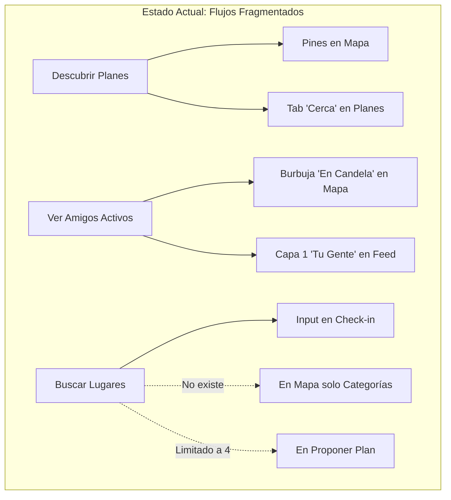
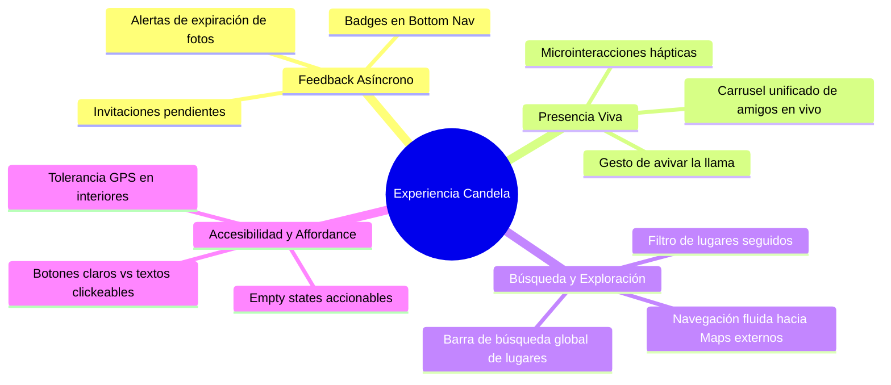
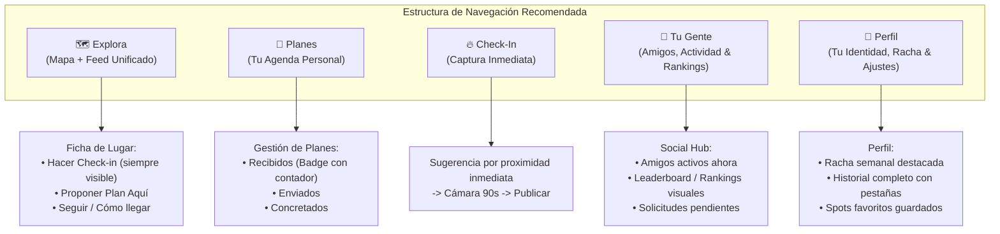

# Auditoría UX/UI y Optimización de Flujos — Candela

> **Documento de Diagnóstico y Plan de Optimización de Experiencia de Usuario**  
> **Fecha:** Septiembre 2026  
> **Área:** Diseño de Producto, UX/UI, Arquitectura de Información  

---

## 1. Diagnóstico Ejecutivo

**Candela** propone una visión diferenciada: *presencia y descubrimiento urbano en tiempo real sin el ruido, vanidad ni adicción de las redes sociales convencionales*. La identidad visual, paleta cromática (ámbar, salvia, noche, arena) y las intenciones de diseño están bien orientadas.

Sin embargo, a nivel de **interacción, arquitectura de información (IA) y experiencia de usuario integral**, la aplicación presenta tres patologías de diseño recurrentes:

1. **Silos de Información y Redundancia:** Tareas y datos vinculados a la misma necesidad del usuario se encuentran divididos artificialmente entre pestañas y modales desconectados.
2. **Callejones sin Salida (Dead Ends):** Pantallas y fichas donde el usuario manifiesta una clara intención de interacción, pero la interfaz no ofrece la acción lógica correspondiente (ej. querer invitar a un amigo al ver un lugar).
3. **Falta de Retroalimentación Activa (Passive Darkness):** Falta de indicadores asíncronos (*badges*, notificaciones de estado) y affordance débil en componentes interactivos clave.

---

## 2. Mapa de Redundancias Actuales en los Flujos Principales



| Tarea Principal | Puntos de Redundancia | Impacto en la Experiencia (UX Pain) | Solución Propuesta |
| :--- | :--- | :--- | :--- |
| **Descubrir Planes Abiertos** | • En el **Mapa** (pines de planes y sheet por lugar).<br>• En **Planes > Tab "Cerca"** (lista de los mismos planes). | **Doble canal de descubrimiento:** El usuario revisa el mapa o la pestaña sin saber cuál tiene la información más fresca o relevante, perdiendo el contexto geoespacial en la lista. | Consolidar los planes abiertos exclusivamente en el **Mapa / Explorador urbano**. La pestaña **Planes** debe operar como **"Tu Agenda Personal"** (Recibidos, Enviados y Confirmados). |
| **Monitorear Amigos Activos ("En Candela")** | • Botón flotante **"En candela"** en el mapa (`_ActiveFriendsButton`).<br>• Capa 1 del **Feed** ("Tu gente"). | **Fragmentación de presencia:** Para ver quién está en la calle, el usuario tiene un botón flotante que abre un modal con una lista, y a la vez una pestaña de Feed que abre fotos verticales de los mismos amigos. | Unificar la presencia viva como una barra/carrusel de avatares activos ("En candela ahora") presente en la cabecera del feed y colapsable en el mapa. |
| **Búsqueda y Exploración de Lugares** | • Buscador de texto en **Check-in** (`_PlaceSelectStep`).<br>• Sin buscador en **Mapa** (solo 7 chips de categorías fijas).<br>• Lista recortada a 4 lugares fijos (`places.take(4)`) en **Proponer Plan**. | **Asimetría de capacidades:** El usuario solo puede buscar un lugar cuando ya está allí para hacer check-in. Si está en su casa planeando una salida, no puede buscar un café específico. | Extraer un componente unificado `PlaceSearchDelegate` o barra de búsqueda superior en el Mapa y selector dinámico en planes. |
| **Gestión de Lugares Favoritos/Seguidos** | • Botón **Seguir** en `place_sheet.dart`.<br>• Capa 2 del **Feed** ("Lugares que sigues").<br>• Ningún acceso en el Perfil. | **Invisibilidad de preferencias:** El usuario puede pulsar "Seguir", pero no tiene un lugar en su perfil o mapa para consultar la lista de sitios que sigue. | Añadir la sección *"Mis Spots / Siguiendo"* en el Perfil o como filtro rápido en el Mapa. |

---

## 3. Análisis Crítico por Tarea del Usuario

### A. Descubrir Qué Hacer y Dónde Ir (Mapa & Feed)

#### Problemas Detectados:
1. **El "Lugar Inactivo" como Callejón sin Salida:**
   * En [place_sheet.dart#L122](file:///c:/Users/Maldonado/Documents/Projects/Nomad%20Table%20like/code/candela_front/lib/app/place_sheet.dart#L122), el botón `_CheckInCta` ("Hacer check-in aquí") tiene la condición:
     ```dart
     if (_place.isActive) _CheckInCta(place: _place)
     ```
   * **Inconsistencia crítica:** Si un lugar no tiene actividad reciente, el encabezado muestra *"Sé el primero en llegar"*, pero **la interfaz no ofrece ningún botón para registrarse**. El usuario asume que no puede hacer check-in. Debe cerrar el sheet, pulsar el botón flotante central (FAB), buscar el lugar manualmente y hacer check-in desde allí.
2. **Falta de Acción Social Directa en el Lugar:**
   * Al explorar un lugar interesante, solo hay opciones de "Seguir" o "Denunciar". Falta un botón primario: **"Armar plan aquí"**, que abra el flujo de propuesta de plan precargando el lugar.
3. **Ausencia de Búsqueda de Texto en el Mapa:**
   * El mapa solo tiene filtros por categorías (`CAFE`, `BAR`, `RESTAURANT`, etc.). Si un usuario busca *"La Popular"* o *"Mondongo"*, no tiene barra de búsqueda en el mapa.

---

### B. Proponer y Coordinar Planes (Social Coordination)

#### Problemas Detectados:
1. **Límite Artificial de 4 Lugares:**
   * En [plan_widgets.dart#L579](file:///c:/Users/Maldonado/Documents/Projects/Nomad%20Table%20like/code/candela_front/lib/app/plan_widgets.dart#L579):
     ```dart
     children: places.take(4).map((p) { ... })
     ```
   * La app solo permite seleccionar entre los 4 lugares más cercanos a la posición actual. No hay paginación, ni buscador, ni opción de elegir otro punto de la ciudad.
2. **Desconexión con el Mapa:**
   * No se puede proponer un plan tocando directamente un pin o la ficha de un lugar en el mapa.
3. **Falta de Estados Claros en Planes:**
   * Cuando un plan es aceptado, no hay atajo para *"Ver cómo llegar"* (abrir en Google Maps/Apple Maps) ni botón para *"Hacer check-in juntos al llegar"*.

---

### C. Registro de Presencia (Flujo de Check-in)

#### Problemas Detectados:
1. **Pérdida de Contexto si Falla el GPS en Interiores:**
   * En discotecas, bares o sótanos, la precisión satelital decae. Si el usuario intenta hacer check-in y la geocerca estricta rechaza la ubicación, el flujo lo expulsa o aborta tras el temporizador de 90 segundos.
2. **Doble Esfuerzo de Selección de Lugar:**
   * Al pulsar el botón central FAB, el usuario casi siempre está parado en el lugar. Sin embargo, se le presenta una lista completa y se le exige tocar el lugar antes de encender la cámara, en lugar de sugerir automáticamente con alta prioridad: *"Parece que estás en [Lugar X] (a 12m) - [Confirmar y Capturar]"*.

---

### D. Relaciones Sociales y Gestión de Círculo (Amigos & Perfiles)

#### Problemas Detectados:
1. **Affordance Oculto para la Lista de Amigos:**
   * La lista de amigos solo se alcanza yendo a `Perfil` y tocando el texto `"Amigos"` (`_StatItem`). No tiene icono de flecha, apariencia de botón ni badge de interacción.
2. **Perfil Ajeno Sin Acciones Recíprocas:**
   * En [user_profile_sheet.dart](file:///c:/Users/Maldonado/Documents/Projects/Nomad%20Table%20like/code/candela_front/lib/app/user_profile_sheet.dart), al tocar un `@usuario` en el feed, se abre una hoja donde se puede ver su nivel y bloquearlo/denunciarlo. **No existe botón para "Agregar como amigo" ni para "Proponerle un plan"**.
3. **Lista de Amigos Unidireccional:**
   * En `FriendsScreen`, tocar a un amigo no permite ver su perfil ni sus últimos check-ins públicos. Solo ofrece *"Proponer plan"* o *"Dejar de ser amigo"*.

---

### E. Gamificación, Racha e Historial (Identity & Progress)

#### Problemas Detectados:
1. **Rankings Fantasma:**
   * Aunque el backend implementa `getFriendsRanking()` y `getGlobalRanking()`, la UI de perfil solo muestra una línea de texto: *"Estás en el puesto #X del ranking de amigos"*.
   * No hay podio visual, no se ve quién lidera el grupo, cuántos puntos separan al usuario del siguiente puesto, ni tabla comparativa.
2. **Duplicidad entre Carrusel de Check-ins e Historial:**
   * El perfil muestra un carrusel horizontal recortado de 5 check-ins y un botón de texto "Ver historial". Ambos compiten por la misma función.

---

## 4. Vacíos Globales en la Experiencia de Usuario (Holistic UX Gaps)



### 1. Sistema de Notificaciones Pasivas / Badges de Estado
Actualmente, el usuario debe explorar la app a ciegas para enterarse de:
* Solicitudes de amistad entrantes.
* Invitaciones a planes pendientes de respuesta.
* Planes que otros amigos aceptaron.

**Solución requerida:** Indicadores de punto ámbar (*badge dots*) en la barra inferior (en *Planes* y en *Perfil*).

### 2. Mecanismo de Presencia Social de Bajo Esfuerzo (*Zero-friction Engagement*)
La filosofía de Candela prohíbe likes y comentarios para evitar la superficialidad. Sin embargo, la experiencia actual resulta excesivamente solitaria y fría.
* **Propuesta UX:** Un gesto efímero de presencia: **"Avivar la llama" / "Prender fuego"** (pulsación larga sobre la foto de un amigo en el feed o visor) que envía una microvibración y una llama animada en tiempo real sin contadores públicos acumulables.

### 3. Integración de Servicios Externos
Cuando un plan es aceptado o un usuario decide ir a un lugar descubierto en el feed:
* Falta botón para **"Abrir en Google Maps / Waze / Uber"**.
* Falta integración con calendario del sistema ("Agendar en mi calendario").

---

## 5. Propuesta de Arquitectura de Información y Navegación Optimizada



---

## 6. Plan de Acción y Quick Wins (Priorización de Implementación)

### Fase 1: Correcciones Críticas de Flujo (Quick Wins - Inmediato)
1. **Habilitar siempre el Check-in en `place_sheet.dart`:**
   * Mostrar el botón `_CheckInCta` tanto si el lugar está activo como si no. Si está inactivo, usar el texto: *"Sé el primero en prender este lugar"*.
2. **Agregar "Proponer plan aquí" en `place_sheet.dart`:**
   * Botón secundario que invoca `showProposePlanSheet(context, initialPlace: _place)`.
3. **Selector de lugares real en `_ProposePlanSheet`:**
   * Eliminar el `.take(4)` en [plan_widgets.dart](file:///c:/Users/Maldonado/Documents/Projects/Nomad%20Table%20like/code/candela_front/lib/app/plan_widgets.dart). Integrar un campo de búsqueda o lista desplazable con todos los lugares cercanos.
4. **Acciones directas en `user_profile_sheet.dart`:**
   * Incorporar botones de *"Agregar amigo"* y *"Proponer plan"* directamente en la hoja del perfil de otro usuario.

### Fase 2: Consolidación y Reducción de Redundancias (Mediano Plazo)
1. **Rediseño de la Pestaña Planes:**
   * Mover la lista de "Planes Cerca" (planes abiertos de extraños) como una capa/filtro interactivo en el **Mapa**.
   * Dejar la pantalla de Planes exclusivamente para compromisos sociales propios (Recibidos, Enviados, Confirmados).
2. **Barra de Búsqueda de Lugares en el Mapa:**
   * Añadir un campo de búsqueda predictiva en la parte superior del mapa para localizar cualquier establecimiento sin depender de las categorías.
3. **Badges de Notificación:**
   * Incorporar un indicador visual de punto ámbar en el Tab de Planes cuando `incomingPlans.where((p) => p.status == pending).isNotEmpty`.
   * Indicador en el Tab de Perfil/Amigos cuando existan solicitudes de amistad pendientes.

### Fase 3: Enriquecimiento de la Experiencia (Largo Plazo)
1. **Leaderboard Visual de Amigos:**
   * Crear una pantalla o modal de Ranking con podio (1º, 2º, 3º lugar) y lista de amigos ordenada por puntuación de temporada.
2. **Microinteracción "Avivar la llama":**
   * Permitir interacciones táctiles directas sobre los check-ins de amigos con retroalimentación háptica.
3. **Accesos a Navegación Externa:**
   * Enlaces directos a aplicaciones de mapas para llegar al destino de un plan.
